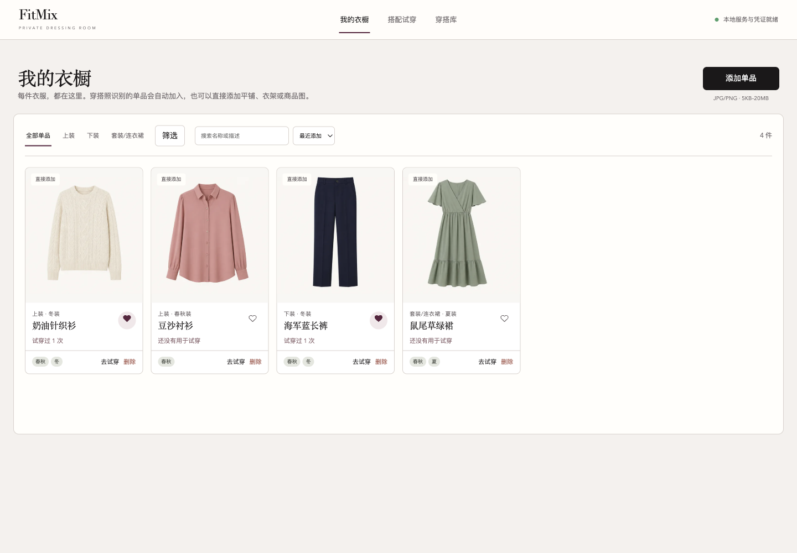
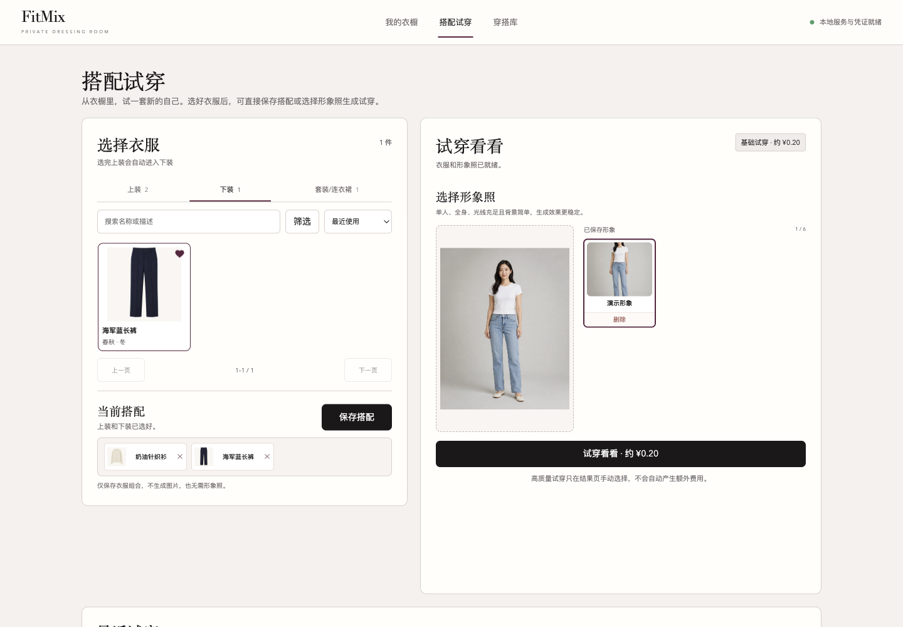
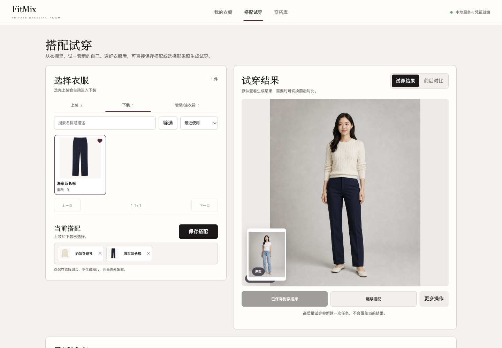
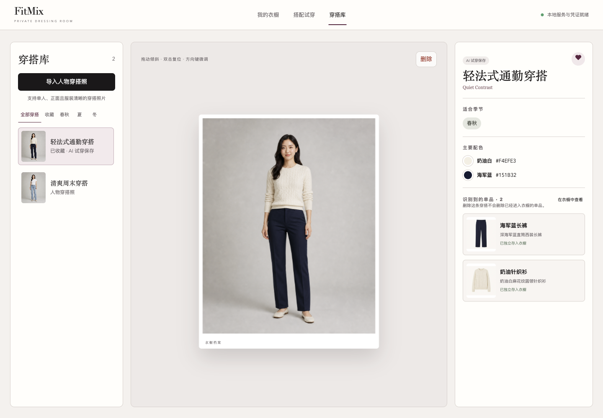

# VestiAI

[中文](README.md)

VestiAI is a local-first digital wardrobe with a browser interface. It organizes garments and outfits, manages profile photos, and creates AI virtual try-on results.

VestiAI builds on [FitMix](https://github.com/betterjally-oss/FitMix) and is released under the MIT license, retaining the original attribution. Existing source commands, configuration, and wardrobe storage remain compatible.

The current release includes backups, duplicate-generation protection, task recovery, model budgets and explicit cost confirmation. Automatic outfit recommendations and a chat agent are planned and are not available yet.

> VestiAI uses BYOK (Bring Your Own Key). This repository contains no default API key; each user supplies their own AI service credentials and pays for their own usage.

## Features

- In Wardrobe, upload a garment or a person outfit photo to extract garments only, without saving the full look
- In Outfit Library, import a full look and sync newly detected garments into the wardrobe
- Organize garments by type, season, favorite, keyword, and recent use
- Combine a top and bottom, or choose a dress, then create basic or high-quality virtual try-ons
- Save a top/bottom combination or a single dress directly to the outfit library
- Save up to six person photos, browse recent generations, and save results to the outfit library
- Edit, favorite, merge, and delete garments without deleting independent try-on history
- Store images and metadata locally in `data/` without an external database

## Screenshots

| Wardrobe | Outfit selection |
| --- | --- |
|  |  |

| AI try-on result | Outfit library |
| --- | --- |
|  |  |

The screenshots show the earlier demo before the rename. They use purpose-made assets and contain none of the author's real garments, people, or history. The current interface is named VestiAI.

## Requirements

- Python 3.11 or newer
- Network access to Alibaba Cloud Model Studio and an enabled Alibaba Cloud account
- A recent version of Chrome, Safari, Edge, or Firefox

VestiAI currently targets the **China North 2 (Beijing)** region. The API key and Workspace ID must belong to that region and the same workspace.

## Get Bailian credentials

1. Sign in to the [Bailian console](https://bailian.console.aliyun.com/), select China North 2 (Beijing), and enable the model service.
2. Follow the [official API key guide](https://help.aliyun.com/zh/model-studio/get-api-key).
3. Follow the [official Workspace ID guide](https://help.aliyun.com/zh/model-studio/obtain-the-app-id-and-workspace-id).
4. Prepare these two values:

```dotenv
DASHSCOPE_API_KEY=your_api_key
DASHSCOPE_WORKSPACE_ID=your_workspace_id
```

Never commit `.env`, an API key, or screenshots containing credentials. The macOS app stores credentials only on the current Mac; the source edition has no browser credential form.

## Model budgets and recovery

Recognition, segmentation and try-on share atomic, cumulative per-job, per-user and application budgets. Unknown submissions retain their estimated cost; the platform bill remains the source of actual charges. Configure positive per-call RMB-cent estimates for `FITMIX_RECOGNITION_CENTS` and `FITMIX_SEGMENTATION_CENTS` in `.env` before importing images; missing estimates block calls. See [.env.example](.env.example). Desktop credentials updates preserve budget configuration. Restart after configuration changes.

Basic/Plus estimates default to 20/50 cents, with 100 cents per job, 1000 cents per ordinary user and the existing 6000-cent application limit. Visitors also retain their existing count and 200-cent cap. Budgets cover all roles and do not reset on refresh or deletion.

A quote alone cannot authorize generation: explicit user confirmation is required. Repeated confirmed requests reuse one task. Waiting tasks resume the original remote ID; uncertain submissions are never automatically recreated. Successful recognition and segmentation steps are cached for download recovery. If no remote ID was received, verify the request in Bailian before taking further action.

Schema version 2 upgrades with an automatic backup and retains unfinished tasks. Existing installed apps need a rebuild to include these changes. No platform billing integration or real-model validation is claimed.

## macOS app (recommended)

The locally built installer supports **Apple Silicon Macs (M1 or newer) running macOS 11 or later** and does not require Python after installation:

1. Follow the macOS installer build instructions below to create `VestiAI-macOS-arm64.dmg`.
2. Open the DMG and drag VestiAI to Applications.
3. On first launch, Control-click VestiAI, choose Open, and confirm. Regular double-click works afterward.
4. Enter your own Bailian Workspace ID and API key in the API Settings dialog.

Wardrobe data and credentials remain in `~/Library/Application Support/FitMix` so existing wardrobes continue to work. The API key is never committed to GitHub or displayed in the settings screen. The original [GitHub Releases](https://github.com/betterjally-oss/FitMix/releases/latest) still provide the older FitMix installer.

## Install from source

Clone the repository first:

```bash
git clone https://github.com/LECoO21/VestiAI.git
cd VestiAI
```

### macOS (source edition)

The setup wizard opens the official Bailian pages, writes credentials to a user-readable-only `.env`, and validates them without creating a paid model task:

```bash
chmod +x scripts/macos/setup.command scripts/macos/start.command scripts/macos/stop.command
./scripts/macos/setup.command
./scripts/macos/start.command
```

The script opens the browser after the server is ready. The source server runs independently in the background and survives closing the launcher terminal. Stop it with `./scripts/macos/stop.command`; check its status with `.venv/bin/python scripts/macos/server.py status`. Startup logs are saved in `data/server-startup.log`. Stop the server before backing up, restoring, or updating it.

### Windows (PowerShell)

```powershell
py -3.11 -m venv .venv
.venv\Scripts\python -m pip install -r requirements.txt
Copy-Item .env.example .env
notepad .env
.venv\Scripts\python -m fitmix.app
```

Fill in both values in Notepad, save the file, then open <http://127.0.0.1:5050>.

### Linux

```bash
python3 -m venv .venv
.venv/bin/python -m pip install -r requirements.txt
cp .env.example .env
${EDITOR:-nano} .env
.venv/bin/python -m fitmix.app
```

Open <http://127.0.0.1:5050>. Press `Control-C` to stop the service.

## Workflow

1. In Wardrobe, upload one garment or a person outfit photo. A person photo is split into garments and does not create a saved look.
2. To keep a complete look, use Import Full Outfit in Outfit Library. Newly detected garments are synced to Wardrobe, while clear duplicates are reused.
3. Review the detected name, type, seasons, and favorite status.
4. In Try On, choose a top plus a bottom, or one dress. Saving the combination alone does not create a billable try-on.
5. Add a clear, front-facing, full-body person photo with a simple background and confirm the estimated cost.
6. Compare, download, continue styling, or save the result to the Outfit Library.

## Costs

These actions call Bailian and are billed to your Alibaba Cloud account:

- Importing an outfit photo: visual understanding and garment parsing
- Adding a garment photo: visual understanding and garment parsing
- Generating a try-on: basic or high-quality OutfitAnyone task

Browsing, searching, filtering, editing, favoriting, saving combinations, and deleting local records do not call a model. The approximately ¥0.20 / ¥0.50 labels in the UI are demo estimates; actual prices, free quotas, and bills follow the [official Bailian pricing](https://help.aliyun.com/zh/model-studio/). Configure budget alerts or limits in Alibaba Cloud.

## Data and privacy

- Git ignores `.env`, `data/`, virtual environments, caches, and OS files.
- SQLite data, originals, garment images, and generated results stay in the local `data/` directory by default.
- AI features upload the relevant images to Bailian for processing; VestiAI is not offline inference.
- Login is disabled by default for local use, and existing local data belongs to the administrator. When hosted-demo passwords are configured, each browser receives an isolated anonymous wardrobe and cannot access another visitor's data.
- Anonymous identity is stored in a signed browser cookie. Clearing browser data creates a new empty wardrobe, so only use demo-safe assets.

## Hosted demo

Configure the deployer's credentials as server environment variables; visitors do not enter an API key:

```bash
export DASHSCOPE_API_KEY="..."
export DASHSCOPE_WORKSPACE_ID="..."
export FITMIX_DEPLOYMENT_PROFILE="demo"
export FITMIX_ACCESS_PASSWORD="visitor password"
export FITMIX_ADMIN_PASSWORD="administrator password"
export FITMIX_SECRET_KEY="a long random value"
export FITMIX_VISITOR_TRYON_LIMIT=3
export FITMIX_VISITOR_BUDGET_CENTS=200
export FITMIX_GLOBAL_BUDGET_CENTS=6000
gunicorn --bind 0.0.0.0:${PORT:-5050} --workers 1 --threads 4 fitmix.app:app
```

Hosted credentials are separate from local BYOK. Visitors can use basic try-on only, with defaults of three generations and ¥2 per anonymous wardrobe; Plus is administrator-only. The app also enforces a default ¥60 global software cap. Keep a separate provider-side spending cap and revoke the temporary key after the demo.

In veFaaS demo mode, SQLite and images default to `/tmp/fitmix-data`, and startup fails when access credentials or the signing secret are missing. `.vefaasignore` excludes the local `.env` and `data/` from the deployment package. Because `/tmp` is erased with the instance, keep one reserved instance for a short demo; use NAS or object storage plus a durable database for reliable long-term retention.

## Troubleshooting

**“Bailian credentials are not configured”**

Check that `.env` exists in the project root and both variables are non-empty, then stop and restart the service.

**Credential, region, or workspace mismatch**

Make sure both values belong to the same China North 2 (Beijing) workspace. On macOS, rerun `./scripts/macos/setup.command` to validate them.

**Upload failed**

Use JPG or PNG with clear clothing, one person, good light, and a stable network connection. Check model permissions in the Bailian console.

**Port 5050 is already in use**

For the macOS source background server, run `./scripts/macos/stop.command`, or check `.venv/bin/python scripts/macos/server.py status`. Closing the launcher terminal does not stop the server. If the port is still occupied, inspect the owning program and avoid stopping unrelated services.

**Model task failed or timed out**

Use “Continue querying” when a remote task ID exists; this resumes the original task without creating another paid generation. If submission is uncertain and no ID was received, verify the original request in Bailian first. Any new generation after a confirmed failure requires a new explicit cost confirmation.

## Uninstall

For the app edition, delete `/Applications/VestiAI.app`. To also remove wardrobe data and local credentials, delete `~/Library/Application Support/FitMix`. For the source edition, stop the service and delete the project folder. Delete the corresponding API key in Bailian to revoke access.

## Build the macOS installer

On an Apple Silicon Mac, run:

```bash
chmod +x scripts/macos/build.command
./scripts/macos/build.command
```

The outputs are `dist/VestiAI.app` and `dist/VestiAI-macOS-arm64.dmg`.

## Development checks

```bash
python3.11 -m venv .venv
.venv/bin/python -m pip install -r requirements.txt
.venv/bin/python -B scripts/check.py
```

The check script uses temporary data, clears real credentials, and blocks live model requests. Node.js is required for frontend checks.

## Backups and recovery

Stop VestiAI before creating or restoring a full backup. Run `python -m fitmix.backup create --data-dir data` with the project virtual environment. The backup includes SQLite (including committed WAL changes) and images, with SHA-256 checksums; it excludes credentials, logs, and thumbnails. The default destination is `backups/`, beside the data directory.

Use `python -m fitmix.backup verify BACKUP_DIRECTORY` to validate a backup, then `python -m fitmix.backup restore BACKUP_DIRECTORY --destination restored-data`. Recovery only writes into a new directory and preserves the original. For the macOS app, use `~/Library/Application Support/FitMix/data` as the data directory. Database upgrades automatically back up existing data; failed migrations roll back and stop startup. See the Chinese README for complete commands and app recovery steps.

## License

[MIT](LICENSE)
