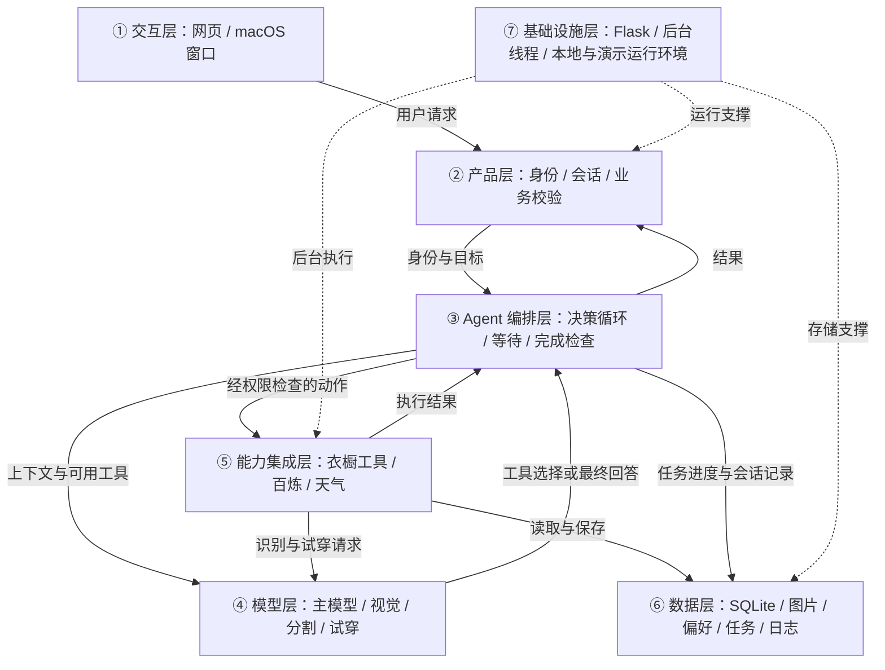

# VestiAI 项目改进与迭代开发方案

> 文档版本：v1.0  
> 状态：开发规划建议稿  
> 依据：本次讨论、VestiAI 当前代码、Agent Blueprint，以及已核对的 GitHub 仓库。
>
> 本文件定义开发路径，问题分析保留方案编写时的代码基线。P0 已按方案实现与模拟验收；其余规划的实时状态以 [开发实施记录](VestiAI开发实施记录.md) 与 [开发优先级排期手册](VestiAI开发优先级排期手册.md) 为准。

## 1. 先用简单的话说清楚

**目标：把 VestiAI 从“需要自己选衣服的 AI 衣橱”，逐步升级成“能理解需求、推荐搭配、协助试穿的搭配助理”。**

最终希望用户这样使用：

> “明天要面试，帮我用已有的衣服搭一套正式一点的，不穿裙子。”

系统查询真实衣橱，推荐几套组合并解释理由。用户选择后，可以保存搭配，或者在费用授权范围内生成试穿图。用户说“太正式了”或“换一套”，系统能接着调整。

开发顺序：

**先把基础处理稳妥 → 自动推荐搭配 → 聊天搭配助理 → 批量整理衣服 → 根据反馈改进推荐。**

现有衣橱、网页界面、SQLite 数据库和百炼试穿接口继续复用。新能力分阶段加入，每阶段都要能独立使用和验收。

### 首轮开发采用的建议范围

- 优先服务个人本地使用，兼容现有 macOS App 和托管演示模式。
- 推荐衣物限定为现有的上装、下装、连衣裙／连体服。
- 完整推荐组合为“一件上装 + 一件下装”或“一件连衣裙／连体服”。
- 单件衣服的手动试穿继续保留；推荐完整搭配与手动单件试穿分别校验。
- 外套叠穿、鞋包配饰、购物商城、尺码测量和 3D 人体暂列后续探索。
- 首轮沿用百炼服务，不新增显卡服务器，不同时接入多个试穿模型。

以上是建议的实施边界，不是用户已经确认的新增业务承诺。

## 2. 项目现状与可以保留的部分

### 2.1 已经具备的能力

| 当前能力 | 后续怎样使用 |
| --- | --- |
| 上传单品照或人物穿搭照，提取衣服 | 作为批量导入和衣橱 Agent 的基础能力 |
| 衣橱查询、搜索、分类、收藏、编辑、重复检测 | 作为 Agent 查询和管理衣物的业务工具 |
| 保存完整穿搭、衣服组合和试穿结果 | 接收自动推荐产生的搭配方案 |
| 上装、下装、连衣裙试穿 | 继续承担实际试穿生成 |
| 最多 6 张形象照 | 让用户选择本次试穿人物，不自动猜测人物身份 |
| SQLite、图片文件和缩略图 | 继续保存业务数据，按阶段增加必要字段 |
| 后台任务、进度、错误和远程任务 ID | 支持 Agent 等待生成结果与恢复任务 |
| 访客隔离、数据归属检查、Plus 权限限制 | 让网页和 Agent 使用同一套权限规则 |
| 本地启动、macOS 打包、测试 | 作为每阶段回归检查与交付基础 |

当前模型配置：

| 模型 ID | 当前职责 | 迭代决定 |
| --- | --- | --- |
| `qwen-vl-plus` | 识别服装类别、可见描述、风格、季节和配色 | 继续用于视觉识别 |
| `aitryon-parsing-v1` | 分割衣物、返回裁剪图和分割图 | 继续用于真实衣物提取 |
| `aitryon` | 基础试穿 | 继续使用 |
| `aitryon-plus` | 高质量试穿 | 保留手动选择及权限限制 |

这些模型目前均通过阿里云百炼调用。数据默认本地保存，AI 处理仍会将相关图片发送到云端。

### 2.2 当前为什么还不是搭配 Agent

当前流程是“用户点按钮 → 代码按固定顺序调用模型 → 保存并展示”。Qwen 的当前调用只做图片分析，没有获得可调用的衣橱工具。

目标 Agent 流程是“用户提出目标 → 模型选择工具 → 执行结果返回模型 → 模型决定下一步 → 检查并交付”。

因此核心缺口是：主决策模型、模型可调用的业务工具、任务上下文、执行结果反馈，以及完成判断。已有多个模型或后台轮询，并不等于已经具备这个闭环。

### 2.3 开发前需要处理的具体问题

1. **付费请求重试**：`submit_tryon()` 使用默认带重试的 `_request()`。如果服务端已经接收请求、但响应在网络中丢失，重复提交可能创建新任务。这是代码中存在的风险路径，本次没有实际复现重复计费。
2. **任务恢复**：`init_db()` 会将未完成的 jobs 和试穿标记为失败。虽然已经保存远程任务 ID，当前没有启动后继续查询的恢复流程。
3. **费用统计范围**：当前软件额度主要覆盖访客的基础试穿，未统一覆盖识别、分割、Plus、推荐和主 Agent 调用。
4. **连衣裙方案保存**：`create_look_from_garments()` 当前要求至少两件单品，并拒绝 dress。自动推荐加入连衣裙后，需要补齐单件完整搭配的保存能力。
5. **推荐数据**：单品当前主要保存分类、描述和季节；结构化颜色、场合及用户偏好需要逐步补充。

## 3. 迭代路线与完成标准

版本号为建议命名，具体发布号在开发时确定。

| 阶段 | 建议版本 | 用户会得到什么 | 完成标志 |
| --- | --- | --- | --- |
| 0：基础整理 | 基础修订版 | 原有功能更可靠 | 权限一致，重复提交受控，已有远程任务可恢复查询 |
| 1：自动推荐 | v0.2 | 输入场合与偏好，获得搭配方案 | 方案使用真实衣物，可保存并进入试穿 |
| 2：聊天助理 | v0.3 | 用自然语言提出需求、换一套、调整方案 | 模型能调用工具，接收结果，按目标继续或结束 |
| 3：批量入库 | v0.4 | 一次整理多张衣服照片 | 逐项识别、审核、去重，失败项可单独处理 |
| 4：个性化反馈 | v0.5 | 保存偏好，根据喜欢／不喜欢调整推荐 | 长期偏好与本次要求分开，反馈可修改和删除 |
| 5：其他试穿引擎 | 可选实验版本 | 比较另一种试穿效果 | 许可、硬件和对比结果满足条件后，才决定是否接入 |

阶段 0–3 构成首轮产品升级。阶段 4 可以在首轮稳定后推进；阶段 5 不进入首轮依赖。

## 4. 每阶段具体怎么做

### 阶段 0：复用现有能力，先处理基础可靠性

**要做的事：**

- 将衣橱查询、搭配保存、试穿提交等能力整理为可复用的业务函数。网页路由和未来 Agent 都调用它们，沿用同一套权限检查。
- 所有用户身份由服务端确定；模型只传衣物、方案和形象照等业务 ID，不能指定别人的 owner。
- 为试穿创建唯一的本地请求记录。重复点击或重复工具调用返回同一记录，不重复生成。
- 分开“查询状态重试”和“创建付费任务重试”。创建结果未知时先记录未知状态，不能自动重新提交。
- 启动后检查保存的远程任务 ID：有 ID 就查询原任务；处于提交中却没有 ID 时，显示“提交结果待核实”，不假装失败或重新创建。
- 将本次费用授权记录在服务端，绑定方案、形象照、质量、有效期和次数。超出已授权范围才需要补充授权。
- 记录各类模型调用的费用估算和用量；配置本次任务、用户和全局上限。平台账单仍是实际计费依据。
- 数据迁移前使用 SQLite 备份接口，或停服后备份完整数据目录；迁移不删除原有记录和图片。

**怎么验收：**

- 连点两次生成只创建一份本地请求；并发提交也不能绕过次数和预算限制。
- 模拟“已接收请求但响应丢失”，系统进入未知状态，不自动重复付费。
- 模拟重启，有远程任务 ID 的试穿继续查询并取回结果。
- 其他用户的单品、形象照、任务和文件无法通过网页或业务函数访问。
- 原有导入、手动搭配、试穿、收藏、删除、历史和 macOS 启动相关检查通过。

**交付：**基础修订版本、迁移说明，以及上述关键行为的回归测试。

### 阶段 1：先让系统会自动推荐搭配

**用户入口：**在“搭配试穿”增加“帮我搭配”，填写场合、偏好及可选天气信息。

**要做的事：**

- 参考 Wardrowbe 的推荐规则：根据场合、季节、颜色和偏好筛选候选衣物，再让模型选组合并解释理由。
- 首先支持用户手动填写天气；接入天气服务后，明确显示城市、更新时间和来源。查询失败时回退为用户提供的信息，不编造实时天气。
- 给单品补充可编辑的颜色、风格和场合标签。旧衣服没有新标签也能参与推荐，优先利用现有描述和季节，不强制付费重新识别全部衣物。
- 使用支持结构化输出的推荐模型，从候选清单中返回衣物 ID、组合名称和推荐理由。具体模型在阶段开始时用样例验证，优先继续采用百炼。
- 默认尝试返回 3 套不同组合；衣物不足时返回实际可用数量并解释缺少什么，不凑出不存在的衣服。
- 服务端检查所有权、衣物是否仍存在、上下装／连衣裙结构、用户排除条件，以及组合是否重复。
- 推荐卡片复用现有单品图片。用户可保存组合、换一套，或带着当前选择进入已有试穿流程。
- 补齐连衣裙／连体服单件方案的保存能力；上下装的原有保存规则继续适用。

**怎么验收：**

- “面试、不穿裙子”的方案只使用本人的现有上装与下装，并给出理由。
- 衣橱只有连衣裙时，允许保存合法单件方案；缺少下装时不会伪造下装。
- 模型返回不存在、越权或不符合分类的 ID，服务端拒绝该方案或在限定次数内重新请求。
- 推荐中途有单品被删除或修改，保存／试穿前重新校验，不使用失效方案。
- 保存后能在穿搭库查看，试穿能复用选中的衣物和形象照。

**注意：**这一阶段形成“自动推荐功能”，还没有完整的自主工具循环。推荐也会调用模型，不能标为免费操作。

### 阶段 2：增加能调用业务工具的聊天搭配助理

**用户入口：**增加“搭配助理”，支持文字输入，并展示搭配卡片、执行进度和试穿结果。

**要做的事：**

- 按蓝图实现一个主 Agent 循环：理解需求、选择工具、读取工具结果、调整行动、完成交付。
- 首批只开放必要工具：查询衣橱、读取单品详情、生成推荐、保存搭配、提交试穿、查询任务结果。
- 主决策角色与视觉识别角色分开配置。主模型必须验证能够正确调用工具；不因为 Qwen 当前能分析图片，就假定它的当前调用方式已经支持 Agent。
- 记录当前会话中的场合、禁忌、选中方案和用户修改。“换一套”保留原有要求，并排除已推荐的同一组合。
- 信息足够时直接执行；缺少会改变结果的信息时，只询问必要部分。没有形象照时展示选择入口，不自行选一个人物。
- 试穿在已授权的图片、质量、次数和预算内执行。只要求推荐时，不自动生成付费试穿或升级 Plus。
- 慢任务返回任务 ID，由现有后台机制等待结果；等待期间保留目标，结果回来后让 Agent 继续，不反复调用模型问“好了没有”。
- 完成检查先采用明确规则：方案有效、要求已满足、任务真正成功、结果文件可访问。风格喜好由用户反馈；暂不增加独立评估模型。
- 设置可配置的调用轮数、时间和预算上限。达到上限或外部服务不可用时，保留进度，说明未完成部分，不宣称成功。

**怎么验收：**

- 用户说“帮我搭一套通勤装”，系统确实查询衣橱并给出真实组合，而非只回复通用建议。
- 用户说“太正式了，休闲一点”，新方案继承“通勤”等未撤销的要求。
- 工具返回失败后，模型能解释原因或选择可行下一步；反复失败后按上限结束。
- 只推荐不试穿；已经授予一次基础试穿权限时，不能重复生成第二次或自动变成 Plus。
- 模型回复“已经生成”不能作为成功证明，必须存在成功任务和有效结果。
- 会话、目标、工具结果和任务均按用户隔离，刷新页面后能恢复可见状态。

**交付：**可使用的聊天搭配助理、工具契约、关键对话样例及自动化验收记录。

### 阶段 3：批量整理衣服，确认后入库

**用户入口：**“添加衣服”支持选择多张图片，展示逐项处理结果与待确认单品。

**要做的事：**

- 参考 Wardrobe 的“批量整理 → 逐项检查 → 确认入库”流程，复用 VestiAI 的识别、分割、后台任务和 draft 能力。
- 每张图片独立记录进度、成功和失败；控制同时处理数量，沿用现有图片格式及大小限制。
- 同一次导入和已有衣橱都做重复提示。哈希相近只能作为线索，不因外观相似就强制合并不同实物。
- 预览后允许修改名称、分类和季节，确认后加入衣橱。未确认的条目不参与正式推荐。
- 仅重试明确失败且允许重试的步骤；创建结果未知的付费步骤沿用阶段 0 的核实方式。
- 保留原图和真实裁剪图。生成式平铺图若以后加入，应作为展示副本，不能替代真实衣物证据。

**怎么验收：**

- 一批图片中部分失败，不影响其他图片的审核和入库。
- 相同请求重复提交或重复确认，不创建第二份正式单品。
- 待审核单品不出现在正式衣橱推荐中；确认后立即可以使用。
- 失败项可单独处理，成功项不重新调用收费模型。
- 用户取消剩余批次时，不再提交新任务；已被云端接受的任务单独标明，不能承诺取消就不会计费。

### 阶段 4：保存偏好，根据反馈改进推荐

**要做的事：**

- 保存用户明确设置的长期偏好，例如喜欢的颜色、偏爱的风格和不喜欢的类别。
- 记录对方案的“喜欢／不喜欢”和可选原因，先采用可解释的规则调整排序。
- 区分“今天不穿裙子”和“以后都不推荐裙子”；本次任务要求不自动变成长期记忆。
- 当前用户指令优先于旧偏好，允许查看、修改、删除偏好和反馈。
- 将实际穿着记录与试穿生成记录分开；生成过试穿图不代表真的穿过。

**怎么验收：**新会话能使用已保存偏好；临时要求不会污染长期偏好；删除偏好后不再影响新推荐；用户之间不共享私人反馈。

### 阶段 5：选择一种其他试穿引擎做对比实验

只有现有百炼试穿在效果、成本或使用条件上存在明确问题时，再进入此阶段。

- 首先确认用途与许可。CatVTON、OOTDiffusion、IDM-VTON 当前为非商业许可，不能直接作为商业版本依赖；商业使用需要另外取得授权。
- 如开展许可范围内的实验，优先尝试相对轻量的 CatVTON，准备带合适显卡的机器和实际运行预算。
- 将模型运行在独立服务中，VestiAI 通过一个试穿接口提交图片并取回结果。
- 先验证单件支持和输入要求，再评估上下装组合。不能假定它们与百炼“双单品输入”完全兼容。
- 使用同一批经授权的人物照和衣物照，对比细节保留、人物一致性、成功率、耗时和实际费用。
- CatVTON 不满足需求时，再比较 OOTDiffusion 或 IDM-VTON；按结果选择一种，不同时维护三个引擎。

**完成标准：**实际对比结果有记录，许可与部署条件明确，原有百炼试穿仍可使用，新引擎的失败不破坏已有数据。

## 5. 外部仓库怎样融入

Star 是讨论当天的快照，只作为关注度参考，不作为功能或可靠性保证。

| 来源 | 核对时 Star | 采用方式 | 实施位置与取舍 |
| --- | ---: | --- | --- |
| [Wardrobe](https://github.com/tandpfun/wardrobe) | 2,217 | 移植批量整理、审核和搭配规则的思路 | 阶段 1、3；其 Codex 技能是外部 Agent 工作流程，不能直接当成 VestiAI 网页内置 Agent；不迁入它的 JSON 数据库 |
| [Wardrowbe](https://github.com/Anyesh/wardrowbe) | 766 | 适配候选筛选、天气／偏好上下文、推荐提示词和 ID 校验 | 阶段 1、4；按 Flask + SQLite 改写，不引入其整套 PostgreSQL、Redis 和前端 |
| [CatVTON](https://github.com/Zheng-Chong/CatVTON) | 1,869 | 独立试穿服务，许可范围内做实验 | 阶段 5；先验证硬件和输入兼容性 |
| [OOTDiffusion](https://github.com/levihsu/OOTDiffusion) | 6,606 | 备选试穿实验 | 阶段 5；不进入首轮安装依赖 |
| [IDM-VTON](https://github.com/yisol/IDM-VTON) | 5,219 | 备选试穿实验 | 阶段 5；根据实测效果选择 |
| [OutfitAnyone](https://github.com/HumanAIGC/OutfitAnyone) | 5,980 | 了解技术和效果，沿用现有百炼服务 | GitHub 仓库只有介绍和演示素材，没有可直接迁入的核心实现 |
| [Agent Blueprint](../../agent-blueprint/BLUEPRINT.md) | 不适用 | 提取必要的循环、工具、权限和完成检查机制 | 阶段 2；不整体复制集成示例，不安装全部 17 个组件 |

Wardrobe 与 Wardrowbe 采用 MIT 许可。复用代码或提示词文件时，保留来源与版权说明。

试穿模型许可依据：[OOTDiffusion LICENSE](https://github.com/levihsu/OOTDiffusion/blob/main/LICENSE)、[IDM-VTON LICENSE](https://github.com/yisol/IDM-VTON/blob/main/LICENSE.txt)、[CatVTON LICENSE](https://github.com/Zheng-Chong/CatVTON/blob/edited/LICENSE)。实际引入时固定使用版本，并复核代码、模型权重和依赖的许可。

前面讨论过的拾搭、ClosetAI、AI Closet 和 StylistAI，作为聊天交互、手机界面和工具调用的补充参考，不作为首轮必须接入的依赖。

## 6. 如何判断每一轮做完了

每阶段交付至少包含：实际可运行功能、相关测试结果、用户操作说明，以及数据迁移／恢复说明。

先采用可观察的验收，不用“AI 看起来回答得不错”代替结果：

| 需要验证的事情 | 验证方法 |
| --- | --- |
| 衣物真实且属于当前用户 | 校验数据库 ID、owner 和文件存在性 |
| 组合完整、没有类别冲突 | 规则检查“上装 + 下装”或“连衣裙／连体服” |
| 用户明确的约束被遵守 | 核对排除条件、锁定单品和当前有效需求 |
| 未越权或重复付费 | 模拟未授权、重复请求、并发提交和提交结果未知 |
| 任务确实完成 | 查询成功状态，并确认结果图片有效可访问 |
| 换一套没有重复同一组合 | 对衣物 ID 集合比较，不只比较方案名称 |
| 偏好记忆正确 | 核对长期／临时区分、指令覆盖和删除后的行为 |
| 原有功能没有回退 | 执行既有测试和主要页面操作检查 |

建议增加一组固定验收场景：正常推荐、衣橱不足、只有连衣裙、不穿裙子、锁定单品、换一套、天气失败、模型输出非法 ID、越权访问、超出预算、重复生成、提交结果未知、重启恢复、批量部分失败，以及删除旧偏好。

这些是拟建立的测试场景，不是已经运行通过的测试结果。所有涉及真实模型的测试都需要使用者提供有效凭证并明确测试费用范围；其余异常与边界优先使用模拟服务验证。

## 7. 开发前仍需确定的事项

| 决策项 | 当前建议 | 最迟确定时间 |
| --- | --- | --- |
| 主模型与推荐模型 | 优先百炼，实测工具调用和结构化输出后选择；允许先共用一个模型 | 阶段 1 开始前确定推荐模型；阶段 2 前确定主模型 |
| 本地个人使用还是商业服务 | 首轮按个人本地与现有演示模式规划 | 商业部署或模型许可实验之前 |
| 模型费用、任务预算与最大轮数 | 作为配置项，依据所选模型价格和样例实测设置 | 真实付费联调之前 |
| 天气来源与城市设置 | 先支持手动信息，再接天气服务；用户选择城市 | 天气功能开发之前 |
| 鞋包、外套、多层试穿 | 首轮保持现有三类；按反馈再扩展数据与引擎能力 | 后续扩展版本之前 |
| 视觉质量、推荐满意度和耗时目标 | 用首轮样例建立基线，再约定目标，暂不编造准确率或时延 | 阶段 1 验收及阶段 5 对比之前 |

## 8. 下一次开始开发时的执行顺序

1. 阅读本手册和当前代码，核对是否已有后续改动。
2. 从阶段 0 开始：备份／迁移、共享业务函数、付费提交幂等和任务恢复。
3. 基础检查通过后，再实现阶段 1 的自动推荐闭环。
4. 每轮开发记录已经完成、尚未完成、验证结果与下一步，不把排队或发起任务当成完成。
5. 外部仓库只引入当前阶段需要的部分，保留来源和许可说明。

## 附录 A：给开发者的实施说明

这部分用于把前面的产品步骤落到代码。模块、数据字段和接口是建议设计，实施时结合最新代码调整；只建立当前阶段实际需要的部分。

### A.1 按蓝图组织七层架构

| 层 | VestiAI 的落地内容 |
| --- | --- |
| ① 交互层 | 现有衣橱／试穿／穿搭库，新推荐卡片、聊天区域和批量审核区域 |
| ② 产品层 | Flask 路由、用户身份、会话、搭配方案、费用确认与业务校验 |
| ③ Agent 编排层 | 主循环、工具分发、上下文、等待结果、预算限制与完成检查 |
| ④ 模型层 | 主决策／推荐模型，现有视觉识别、衣物分割、基础／Plus 试穿模型 |
| ⑤ 能力集成层 | 衣橱业务工具、百炼接口和按需接入的天气服务 |
| ⑥ 数据层 | SQLite、原图、裁剪图、结果图、任务记录、偏好和日志 |
| ⑦ 基础设施层 | 本地 Flask／Gunicorn、后台线程、macOS App；持续云部署另行设计持久化 |

一条完整数据流：用户输入 → 服务端确认身份与目标 → 主模型选择衣橱工具 → 查询本人单品 → 生成并校验推荐 → 按授权提交试穿 → 后台返回真实结果 → 完成检查 → 展示和保存。

安全边界与可观测性贯穿各层。模型输出、旧消息、衣物描述和工具返回中的文本都不能更改系统权限；不向模型暴露 API Key、任意 SQL、Shell 或任意文件路径工具。

### A.2 模块安排

| 文件／模块 | 负责什么 | 开始阶段 |
| --- | --- | --- |
| `fitmix/app.py` | 保留 Flask 路由与页面入口，逐步减少路由内重复业务逻辑 | 0 |
| `fitmix/services/wardrobe.py`（拟新增） | 查询单品、校验组合、保存搭配；接收服务端确定的用户上下文 | 0 |
| `fitmix/services/tryon.py`（拟新增） | 费用授权、唯一请求、提交与恢复；封装现有试穿能力 | 0 |
| `fitmix/bailian.py` | 继续提供模型调用；按调用性质区分重试，并增加经过验证的推荐／工具调用方式 | 0–2 |
| `fitmix/services/recommendation.py`（拟新增） | 候选筛选、偏好／天气上下文、结构化输出和推荐校验 | 1 |
| `fitmix/agent.py`（拟新增） | 一个主 Agent 循环、工具注册和结果反馈 | 2 |
| `fitmix/services/import_batch.py`（拟新增） | 批量图片处理、待审核条目、确认入库与失败项处理 | 3 |
| `fitmix/templates/index.html` 与 `fitmix/static/` | 在现有界面加入相应区域，必要时按功能拆分 JavaScript | 各阶段 |
| `tests/` | 扩展现有 unittest，验证新行为及费用、权限、恢复边界 | 各阶段 |

先使用当前 Python、Flask、SQLite 和后台线程。一个本地衣橱 Agent 不需要先升级为多服务系统，也不需要为了参考外部仓库改用 React 或 PostgreSQL。

### A.3 数据演进

| 新增／扩展内容 | 最少保存的信息 | 约束 |
| --- | --- | --- |
| 单品属性 | 可编辑颜色、风格、场合标签 | 保留现有 type、描述与季节；没有证据的品牌、尺码和材质不猜测 |
| 推荐方案 | owner、衣物 ID、场合、约束、理由、创建时间 | 与用户衣橱绑定；保存和试穿前再次检查单品状态 |
| 用户偏好 | 明确设置的长期偏好、更新时间 | 与本轮要求分开；可编辑和删除 |
| 会话与 Agent 运行 | owner、session ID、目标、有效约束、消息、状态、关联方案和 job ID | 不把照片 Base64 或密钥写入聊天历史 |
| 生成请求／授权记录 | 唯一请求标识、方案与形象照、质量、次数、预算、有效期、远程 task ID、提交状态 | 原子消费，重复调用复用结果；由用户授权路径产生，模型不能自报授权 |
| 模型用量 | 调用类型、请求标识、token／图像用量、估算费用、费用状态 | 实际费用未核实时标为未知或估算；不因超时直接认定免费 |
| 导入批次 | 每项来源、状态、待审核单品、关联 job、错误 | 已确认条目不重复入库，未知提交不自动重发 |
| 推荐反馈 | 方案 ID、喜欢／不喜欢、可选原因、是否实际穿着 | 用户隔离；试穿历史不自动计为真实穿着 |

继续在 SQLite 内实现必要的原子更新，不先引入独立任务队列或向量数据库。首轮保留三种衣物类型，外部仓库的鞋包、外套和多层组合规则不能直接套入当前数据模型。

Agent 运行建议状态为：`queued`、`running`、`waiting_user`、`waiting_result`、`completed`、`failed`、`cancelled`、`limit_reached`。等待用户时记录是缺少信息还是等待费用授权；等待结果时关联原 job。状态名称在实现时统一，不要求重命名已有 jobs 状态。

### A.4 首批工具与接口

| 模型工具 | 输入重点 | 返回内容 | 副作用 |
| --- | --- | --- | --- |
| `search_wardrobe` | 分类、季节、关键词及排除条件 | 本人候选单品 ID 与必要属性 | 只读 |
| `get_garment` | 单品 ID | 本人单品详情和可用状态 | 只读 |
| `recommend_outfits` | 场合、当前约束、锁定／排除单品 | 经程序校验的方案及理由 | 模型调用可能计费；先检查预算 |
| `save_outfit` | 有效方案 ID | 穿搭库记录 ID | 本地写入，校验所有权与重复保存 |
| `submit_tryon` | 有效方案、形象照、质量和已获授权的请求 ID | job ID 和提交状态 | 可能计费；权限、次数、预算和幂等校验在服务端 |
| `get_job_result` | job ID | 状态、错误或真实结果 | 只查询已有任务，不创建新生成 |

每个工具都有明确的参数结构、返回结构与错误类型。owner 从当前用户上下文注入；非法参数、数据不足、无权限、待授权、预算不足、远程失败和提交未知分别反馈，不能全部包装成“请重试”。

用户选择推荐后，复用 `/api/looks/from-garments` 和 `/api/tryons` 等业务路径，并补齐连衣裙及生成请求校验。建议新增推荐、会话／消息、Agent 运行查询、批次／确认等接口；具体 URL 在对应阶段确定，保持已有 API 的兼容性。

例子：“帮我推荐”只调用查询和推荐；“保存第二套”保存明确对应的方案；“用这张形象照生成一次基础试穿”才进入相应授权与提交路径。生成请求的确认接口不作为模型工具开放。

### A.5 蓝图组件的取舍

| 蓝图组件 | 本项目采用方式 |
| --- | --- |
| s01 Agent Loop、s02 Tool Use | 阶段 2 必需，实现一个主循环和小型业务工具集 |
| s03 Permission | 复用既有用户隔离，补费用授权、预算和业务对象检查 |
| s04 Hooks | 先在统一执行入口记录日志、检查输入与输出；扩展需求出现后再抽象钩子 |
| s05 TodoWrite | 简单推荐不引入任务清单；复杂多步需求出现后再考虑 |
| s06 Subagent、s13 Agent Teams | 首轮不采用，单个搭配助理足够 |
| s07 Skill Loading | 先保存少量搭配规则与提示词；知识规模增大后再按需加载 |
| s08 Context Compact | 阶段 2 先限制上下文并保留有效目标、约束和最新结果；长会话确有需要时再增加摘要 |
| s09 Memory | 先实现结构化偏好与会话状态；阶段 4 再加入经过筛选的长期反馈 |
| s10 Task System | 使用 SQLite 保存 Agent 运行与关联任务；首轮不建立通用任务依赖图 |
| s11 Background Tasks | 复用现有后台任务，增加结果回传与恢复 |
| s12 Cron Scheduler | 每日主动推荐不属于首轮；用户需要时再增加定时任务 |
| s14 MCP | 本地业务函数可直接作为工具，首轮不需要 MCP 服务 |
| s15 Integrated Harness | 只集成本次选择的机制，不复制其整套工具与团队运行时 |
| s16 Workflow Runtime | 继续用确定的识别／试穿业务流程；复杂固定编排需要 journal 时再引入 |
| s17 Goal Loop | 先用业务规则判断交付完成；独立模型判断器属于可选增强，不能替代真实验证 |

### A.6 验证与发布方式

- 优先扩展现有 `tests/test_app.py`、`tests/test_bailian.py` 和 `tests/test_desktop.py`；按复杂度增加新测试文件。
- 核心测试验证真实业务结果，不只判断模型是否说“完成”。模拟服务应覆盖任务成功、失败、网络断开和提交未知。
- 复用项目的 unittest、脚本语法检查和 Gunicorn 配置检查；涉及桌面包或页面改动时，再增加对应实际检查。
- 每阶段保持可退回旧功能的入口。数据库回退使用经过核验的备份和对应程序版本，不能只替换代码后继续写新数据库。
- 本地／Mac App 持续保存数据；现有 veFaaS 演示的 `/tmp` 不是长期存储。要转长期云服务时，另行落实持久化、备份和恢复，不将短期演示当成生产部署。

## 附录 B：来源与核验边界

本方案核对过的本地依据：

- [项目说明](../README.md)：当前功能、安装、费用与数据位置。
- [业务后端](../fitmix/app.py)：数据结构、任务执行、搭配保存、权限与额度。
- [模型接口](../fitmix/bailian.py)：四个模型 ID、提交重试和任务查询。
- [前端交互](../fitmix/static/app.js)：当前搭配、费用确认、任务轮询和结果展示。
- [业务测试](../tests/test_app.py) 与 [模型接口测试](../tests/test_bailian.py)：已有验证范围。
- [完整蓝图](../../agent-blueprint/BLUEPRINT.md) 与 [方案版蓝图](../../agent-blueprint/BLUEPRINT_PLAN_ONLY.md)：组件取舍与架构方法。

关键外部依据：

- [Wardrobe 批量导入流程](https://github.com/tandpfun/wardrobe/blob/main/.agents/skills/import-clothes/SKILL.md)、[搭配生成流程](https://github.com/tandpfun/wardrobe/blob/main/.agents/skills/generate-outfits/SKILL.md) 与 [MIT 许可](https://github.com/tandpfun/wardrobe/blob/main/LICENSE)。
- [Wardrowbe 推荐服务](https://github.com/Anyesh/wardrowbe/blob/main/backend/app/services/recommendation_service.py)、[推荐提示词](https://github.com/Anyesh/wardrowbe/blob/main/backend/app/prompts/recommendation.txt) 与 [MIT 许可](https://github.com/Anyesh/wardrowbe/blob/main/LICENSE)。
- 第 5 节所列试穿模型仓库、官方 README 和许可证。

已证实：当前代码结构、调用方式、缺少主工具循环、相关仓库中的流程和许可证。尚未验证：外部项目在本机的完整运行效果、新主模型的工具调用表现、实际模型账单、新方案的推荐满意度及其他试穿模型的实测效果。

方案编写阶段仅形成规划；后续实际交付与核验边界见 [开发实施记录](VestiAI开发实施记录.md)。收费模型效果与平台账单尚未通过真实联调核验。

